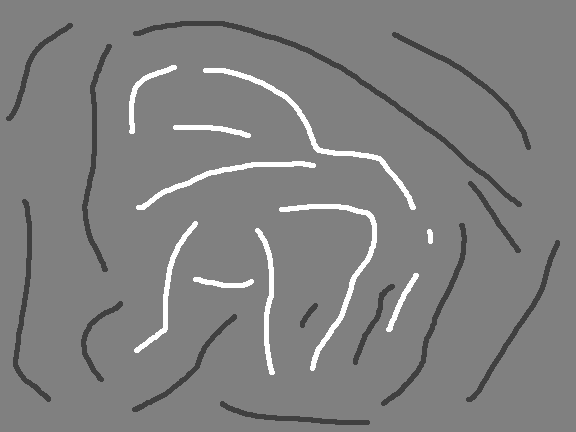
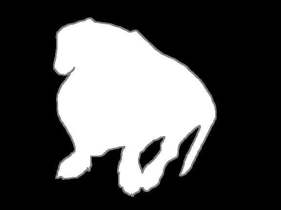

# LPCN — Interactive Image Segmentation using Label Propagation through Complex Networks

MATLAB implementation of the **Label Propagation through Complex Networks (LPCN)** method for interactive image segmentation, associated with the paper:

> Breve, Fabricio Aparecido. "Interactive image segmentation using label propagation through complex networks." *Expert Systems with Applications*, **123**, 18–33 (2019). https://doi.org/10.1016/j.eswa.2019.01.031

- [Published article (DOI)](https://doi.org/10.1016/j.eswa.2019.01.031)
- [arXiv preprint](https://arxiv.org/abs/1901.02573)
- [Author-hosted accepted manuscript (PDF)](https://www.fabriciobreve.com/artigos/2019/ESWA.pdf)

## Overview

LPCN uses a small set of user-provided labels (scribbles) to segment an image. The algorithm proceeds in two stages:

1. **Coarse label propagation:** construct a `k`-nearest-neighbor complex network at reduced image resolution and propagate labels.
2. **Boundary refinement:** use an eight-neighbor pixel grid at the original resolution to refine the segmentation.

The method supports foreground/background segmentation as well as multiple classes.

## Quick start (MATLAB)

The repository includes a runnable example with the image and its corresponding scribbles and ground truth.

1. Open MATLAB and set the current folder to this repository.
2. On **64-bit Windows**, the repository includes the precompiled `lpcnloop.mexw64` and `lpcnloop2.mexw64` MEX functions. If these binaries are not compatible with your MATLAB installation, compile them from the supplied C sources (see below).
3. Execute:

```matlab
example
```

The example loads `ralph.jpg`, `ralph-scribble.png`, and `ralph-gt.png`, runs LPCN, reports the segmentation error and execution time, and displays the input and resulting images.

### Example inputs

| Original image | User-provided scribbles | Ground truth |
| --- | --- | --- |
|  |  |  |

## Requirements and MEX compilation

This project uses MATLAB, including functionality from the **Image Processing Toolbox** (image operations and display) and **Statistics and Machine Learning Toolbox** (for example, `knnsearch` and `zscore`). It also requires the two MEX routines used during label propagation.

The repository contains both the C source files and Windows 64-bit MEX binaries. On Linux, macOS, or an incompatible Windows MATLAB environment, configure a supported C compiler for your MATLAB release and build the MEX functions from the repository root:

```matlab
mex -setup C
mex lpcnloop.c
mex lpcnloop2.c
```

MATLAB generates binaries with a platform-dependent extension (for example, `.mexw64` on 64-bit Windows). The provided Windows binaries and the compilation instructions have not been validated here against every MATLAB release and operating system.

## Main files

| File | Purpose |
| --- | --- |
| `lpcn.m` | Main two-stage image segmentation method |
| `lpcnloop.c`, `lpcnloop2.c` | C sources for the label propagation MEX functions |
| `lpcnloop.mexw64`, `lpcnloop2.mexw64` | Precompiled Windows 64-bit MEX functions |
| `example.m` | End-to-end demonstration using the included images |
| `own2img.m` | Converts the output class assignments to an image |
| `imgeval.m` | Computes segmentation error for the example's evaluation protocol |
| `ralph.*`, `ralph-scribble.png`, `ralph-scribblemix.jpg`, `ralph-gt.png` | Example input and reference images |

### Function interface

```matlab
[owner, pot, ti1, ti2] = lpcn(img, imgslab, fw, k, sigma, disttype, omega, maxiter);
```

- `img`: RGB image (`uint8`, height × width × 3).
- `imgslab`: grayscale scribble-label image (`uint8`, same height and width). In the default binary case, `0` is an ignored region, `64` denotes background, `128` denotes unlabeled pixels, and `255` denotes foreground. Other grayscale label values can represent additional classes.
- `fw`: nine feature weights (default `ones(1,9)`).
- `k`: nearest neighbors in the first stage (default `10`; `0` skips this stage).
- `sigma`: Gaussian edge-weight width (default `0.5`).
- `disttype`: distance metric for `knnsearch` (default `'euclidean'`).
- `omega`: convergence tolerance (default `1e-4`).
- `maxiter`: maximum number of iterations in each stage (default `500000`).

The outputs are the per-pixel class assignments (`owner`), class potentials (`pot`), and iteration counts for the two stages (`ti1` and `ti2`). See the header comments in `lpcn.m` for details.

## Implementation history

The repository was initially published alongside the 2019 paper. The code and precompiled MEX binaries received optimizations and bug fixes on **January 13, 2026**. Accordingly, the current `master` branch should not automatically be treated as an exact snapshot of the 2019 implementation. The Git history preserves earlier versions for historical comparison.

## Citation

If you use this implementation in academic work, please cite the published article:

```bibtex
@article{breve2019interactive,
  author  = {Breve, Fabricio Aparecido},
  title   = {Interactive Image Segmentation Using Label Propagation Through Complex Networks},
  journal = {Expert Systems with Applications},
  volume  = {123},
  pages   = {18--33},
  year    = {2019},
  doi     = {10.1016/j.eswa.2019.01.031}
}
```

## License

The original source code in this repository is licensed under the [Apache License, Version 2.0](LICENSE). Copyright © 2019–2026 Fabricio Aparecido Breve.

Example images or other third-party materials included in the repository are not automatically covered by the source-code license. Their use and redistribution remain subject to any applicable third-party rights and terms.
